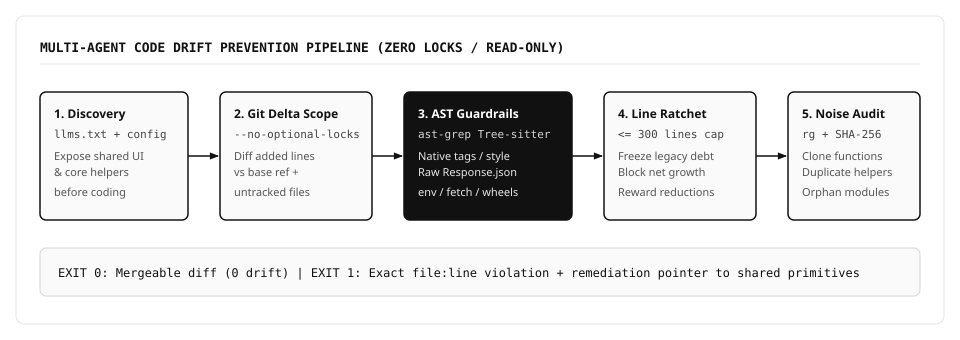

# agent-arch-guard

[](https://github.com/zanehu-ai/agent-arch-guard/actions/workflows/ci.yml)


**Deterministic AST architecture guardrails & code-noise auditor to stop multi-agent coding drift.**  
Built on **Node 22 native TypeScript (zero build step, zero runtime npm dependencies)** + **`ast-grep` (Tree-sitter)** + **`ripgrep`** + **read-only Git `--no-optional-locks` diff ratchets**.

<p align="center">
  
</p>

> Deep dive on the engineering workflow behind this tool: [1 Person + N Agents in Production — Zane Hu](https://zanehu.ai/posts/multi-agent-engineering-sop)

---

## Why prompt rules alone fail in AI coding

When multiple coding agents work concurrently in a repository:

1. **Discovery Blindness**: An agent does not know your shared `@acme/ui` `Button` or `@acme/core/http` `handleJson()` exists, so it takes the shortest path to green — emitting raw `<button>`, inline `style={{}}`, `fetch()`, and `Response.json()`.
2. **Code Clones & Monoliths**: Agents optimize for local compilation, copying `formatMoney()` across modules and growing legacy files past maintainability limits.
3. **Markdown Rules Are Advisory**: System prompts and `.cursorrules` are weak hints. Deterministic engineering requires **fast AST + ratchet gates in CI**.

`agent-arch-guard` solves this with **incremental diff ratchets** (freezing existing technical debt while blocking new violations on added/modified lines) and **whole-repo structural clone & orphan detection**.

---

## 9 Deterministic Guardrail Rules

| Rule ID | Target Scope | What It Blocks | How It Guides the Agent |
| --- | --- | --- | --- |
| `no-scattered-css` | Business `.css` / `.scss` | New local patch stylesheets outside `allowedGlobalCssNames` | Consolidate into shared UI package or design tokens |
| `no-important-css` | CSS diffs | Newly added `!important` overrides | Fix selector specificity or use component variants |
| `no-native-form-controls` | `.tsx` / `.jsx` | Raw `<button>`, `<select>`, `<textarea>`, non-hidden `<input>` | Point directly to shared UI primitives |
| `no-inline-style` | `.tsx` / `.jsx` | JSX `style={{ ... }}` objects | Use design tokens / styling classes |
| `file-line-ratchet` | All business code | New files `> 300` lines or oversized files gaining net lines | Reward refactors that shrink lines; block bloat |
| `no-raw-response-json` | Server API routes | Bare `Response.json()` / `NextResponse.json()` | Route through `@acme/core/http` response wrapper |
| `no-scattered-process-env` | Business modules | Direct `process.env.*` outside `config`/`env` (`NODE_ENV` exempt) | Centralize env parsing & validation |
| `no-raw-view-fetch` | `.tsx` / `.jsx` | Raw `fetch()` calls inside UI views | Route through typed client SDK layer |
| `no-duplicate-helper` | Non-formatter modules | Local re-declaration of `formatMoney`, `formatDate`, `parseAmount`, `readableError` | Import from canonical shared formatter module |

Plus **`noise` auditor** categories:
- **A. Duplicate Helper Symbols** across multiple business files
- **B. Normalized AST/Body Clone Groups** (SHA-256 fingerprint stripping comments & whitespace)
- **C. Oversized Monoliths (`> maxFileLines`) & Suspected Orphan Modules**

---

## Sample Guardrail Output

Running `node src/cli.mts check --all --config examples/arch-guard.json --cwd examples/fixture-app`:

```text
[agent-arch-guard] mode=all engine=ast-grep branch=main checked=4 files
FAIL: 11 violation(s) detected:

  [no-raw-response-json] apps/api/checkout/route.ts:8
    Code: Response.json({ error: "Missing key" }, { status: 500 })
    Fix : Avoid raw Response.json / NextResponse.json in endpoints. Wrap responses through @acme/core/http...

  [no-scattered-process-env] apps/api/checkout/route.ts:6
    Code: process.env.PAYMENT_GATEWAY_KEY
    Fix : Centralize process.env access inside dedicated config/env modules...

  [no-native-form-controls] apps/web/BadCheckout.tsx:14
    Code: <input type="text" placeholder="Order note" />
    Fix : Replace native form element with shared primitive from @acme/ui...

  [no-important-css] apps/web/patch.css:2
    Code: color: #111111 !important;
    Fix : Avoid !important overrides. Compose @acme/ui variants...
```

> Uses `git --no-optional-locks` exclusively — safe for concurrent subagents and parallel CI workers without `.git/index.lock` contention. Comments and string literals are completely ignored when `ast-grep` is active.

---

## Quick Start (3 Steps)

### 1. Requirements
- **Node.js `>= 22.6`** (native `.mts` execution, zero dependencies to install)
- Recommended: **`@ast-grep/cli`** (`npm i -g @ast-grep/cli` or `brew install ast-grep`) and **`ripgrep`** (`rg`). *(Gracefully degrades to comment-stripped fallback scanning unless `--require-ast-grep` is specified.)*

### 2. Initialize config in your repo

```bash
node path/to/agent-arch-guard/src/cli.mts init --cwd /path/to/your-repo
```

### 3. Run incremental PR check & noise audit

```bash
# Block only new architectural drift against main (ideal for CI & agent pre-PR gates)
node src/cli.mts check --base main --require-ast-grep --cwd /path/to/your-repo

# Audit duplicate helper functions, structural clones, monoliths, and orphan files
node src/cli.mts noise --cwd /path/to/your-repo

# Run this repo's 14+ automated tests locally
node --test tests/*.test.mts
```

---

## Configuration (`.arch-guard.json`)

```json
{
  "uiPackageName": "@acme/ui",
  "corePackageName": "@acme/core",
  "coreHttpPackageName": "@acme/core/http",
  "businessDirs": ["apps", "src"],
  "sharedUiDirs": ["packages/ui", "src/ui"],
  "coreDirs": ["packages/core", "src/lib"],
  "excludedPaths": ["node_modules", "dist", ".next", "coverage"],
  "maxFileLines": 300,
  "rules": {
    "no-scattered-css": true,
    "no-important-css": true,
    "no-native-form-controls": true,
    "no-inline-style": true,
    "file-line-ratchet": true,
    "no-raw-response-json": true,
    "no-scattered-process-env": true,
    "no-raw-view-fetch": true,
    "no-duplicate-helper": true
  }
}
```

Auditable per-line escape hatches exist when justified (for example `// arch-guard-allow-inline-style` or `/* arch-guard-allow-important */`).

---

<details>
<summary>简体中文文档（Chinese Guide — 点击展开）</summary>

### 为什么需要 `agent-arch-guard`？

多 Agent 并行研发时，单靠 `AGENTS.md` / `.cursorrules` 提示词根本拦不住“架构漂移”：Agent 的局部目标是让编译最快变绿，很容易绕开团队 `packages/ui` 与 `packages/core` 底座，在业务目录里手写 `<button>`、`style={{}}`、裸 `fetch()`、`Response.json()`，或者复制粘贴 `formatMoney()` 造轮子。

`agent-arch-guard` 用 **Node 22 原生 TypeScript（零运行时第三方依赖）+ `ast-grep` 真 Tree-sitter 语法树 + `ripgrep` + 只读 Git `--no-optional-locks` 增量棘轮**，把规范变成确定性的自动化质量门禁：

- **存量债务冻结，增量严格零容忍**：`--base main` 模式下只校验相对基线分支的新增/修改代码行；超过 300 行的存量老文件禁止净增行数，若成功重构减行还会记录正向激励。
- **并发安全**：全部 Git 调用强制 `--no-optional-locks`，多 Agent 并发检查不抢 `.git/index.lock`。
- **代码消噪审计（`noise`）**：自动识别 A 类跨文件重复 helper 声明、B 类去掉注释空白后的函数体克隆指纹（SHA-256）、C 类超 300 行单体巨石文件与零引用的孤儿模块。
- **9 条可配置规则 + 完整单测**：仓库内置正反例 `examples/fixture-app` 与 14 项 `node --test` 自动化测试。

深度工程实践文章： [1 Person + N Agents 生产研发工程纪律：隔离工位、写审分离与 5 层 AST 门禁](https://zanehu.ai/zh/posts/multi-agent-engineering-sop)

</details>

---

## Author & Links

- Author: **Zane Hu** — [zanehu.ai](https://zanehu.ai) | [GitHub](https://github.com/zanehu-ai) | [LinkedIn](https://www.linkedin.com/in/zanehu-ai/)
- License: MIT
